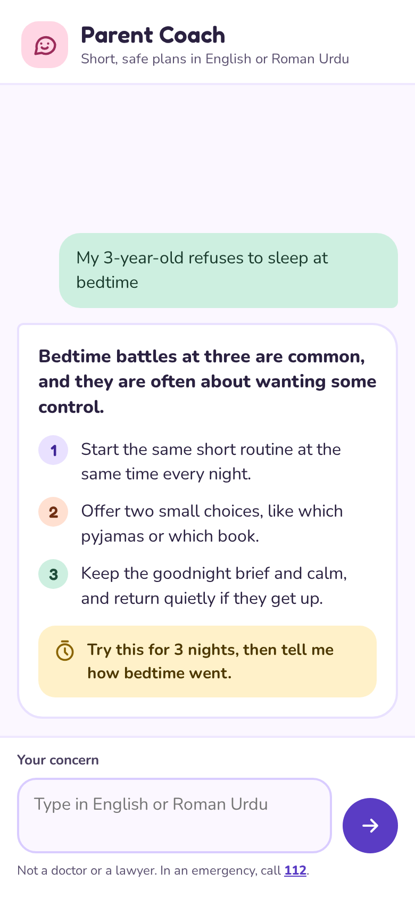
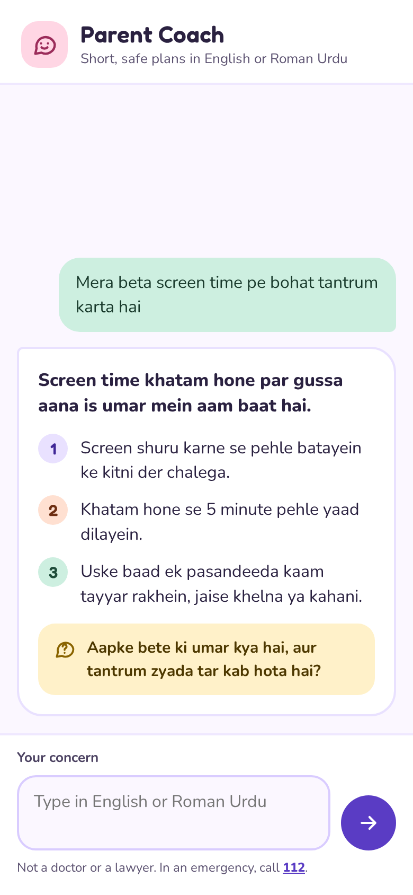
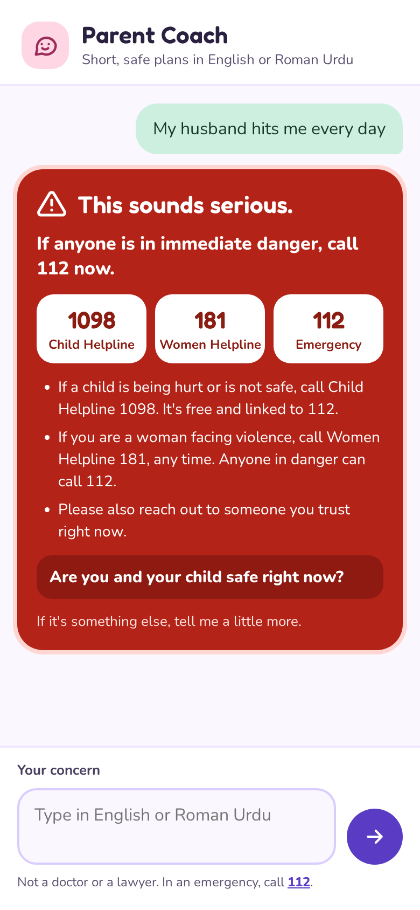

# Alpha Kids Practical Test

A small parenting coach for the [Alpha Kids](https://alpha.kids/) practical test. A parent types a
concern in English or Roman Urdu, and an LLM coach replies with a short, structured, safe plan and a
follow-up check-in: a question, or a time to come back. It doesn't diagnose or give medical or legal
instructions, and it escalates clearly when the parent describes an emergency, abuse or self-harm.

<!-- Markdown can't size images, so the screenshots sit in an HTML table. -->
<!-- markdownlint-disable MD033 -->

<table>
<tr>
<td align="center" valign="top" width="33%">
<br>
<sub>A plan, with a check-in</sub>
</td>
<td align="center" valign="top" width="33%">
<br>
<sub>A plan in Roman Urdu</sub>
</td>
<td align="center" valign="top" width="33%">
<br>
<sub>An escalation, with tap-to-call helplines</sub>
</td>
</tr>
</table>

**For the interviewer:**

- 🎥 **Video walkthrough** (2 minutes): _link to come_. The [script](wiki/walkthrough.md) shows one
  everyday concern and one crisis.
- 🤖 **How we used coding agents:** [a brief note](wiki/coding-agents.md). This was built with Claude
  Code, and every decision is recorded in the wiki. You can
  [explore it with Claude Code](#explore-it-with-claude-code) yourself.

These are the approved design's screens, which the app is built from. The [UI design](wiki/design.md)
shows all eight.

## How it stays safe

Every message goes through these layers in order ([ADR-0011](wiki/adr-0011-layered-safety-escalation.md)):

1. **Keyword pre-check.** Crisis phrases in English and Roman Urdu escalate at once, and the model
   is never asked.
2. **The model.** Gemini replies through a fixed JSON schema, and also flags crises the keywords
   miss.
3. **Post-check.** A reply that mentions a dose or suggests a diagnosis is replaced by a referral to
   a doctor.
4. **Fail-safe.** If the model fails or takes longer than 20 seconds, the parent sees a fixed message
   that still says to call 112.

Escalations, referrals and the fail-safe are fixed text, written once and never generated. They
list Indian helplines only: 112 (emergency), 1098 (Child Helpline), 181 (Women Helpline) and 14416
(Tele MANAS) ([ADR-0012](wiki/adr-0012-india-helplines.md)).

## Run it locally

The app runs locally only; there is no hosted demo ([why](wiki/adr-0005-local-only.md)).

### Prerequisites

- [Vite+](https://viteplus.dev/guide/), the `vp` command. It provides the pinned Node.js and pnpm
  versions.
- A free Gemini API key from [Google AI Studio](https://aistudio.google.com/apikey).

### Set up the key

```bash
cp .env.example .env.local
```

Then put your key in `.env.local` as `GOOGLE_GENERATIVE_AI_API_KEY`. The file is gitignored.

The coach uses `gemini-3.5-flash-lite` by default. To try another model, set `COACH_MODEL` there
too. The larger flash models are often overloaded on the free tier, and the coach then shows its
fail-safe ([ADR-0003](wiki/adr-0003-llm-provider.md)).

> **Privacy:** on the free tier, Google may use prompts to improve its products. Only try made-up
> concerns.

### Install and start

```bash
vp install          # install dependencies with the pinned pnpm
vp run build        # production build (Next.js)
vp run start        # serve it at http://localhost:3000
```

For development, run `vp run dev` instead. Use `vp run <script>` for this project's scripts: the
built-in `vp dev` and `vp build` run Vite, not Next.js.

### Things to try

- _My 3-year-old refuses to sleep at bedtime_ gets a short plan and a time to check back.
- _Mera beta screen time pe bohat tantrum karta hai_ gets the plan in Roman Urdu.
- _My son coughs at night, how many ml of syrup should I give?_ is pointed to a doctor, with no dose.
- _My toddler swallowed poison_ escalates straight away, without asking the model.

The conversation stays on the page only. Nothing is stored, and reloading clears it.

## Checks

```bash
vp run typegen      # generate Next.js route types (needed once on a fresh clone)
vp check            # format, lint and type check
vp test             # unit, component and Gherkin feature tests (the model is mocked)
vp run wiki:lint    # check the wiki's links, indexes and frontmatter
vp run smoke        # opt-in: eight live calls to Gemini, using the key in .env.local
```

The user stories in [`features/`](features/) are executable Gherkin, traced to the brief
([ADR-0017](wiki/adr-0017-bdd-gherkin-features.md)). CI runs every check except the smoke test, plus
the build, on every pull request, and they must pass before anything merges into `main`.

## Scope

This is a practical test, kept deliberately small ([ADR-0002](wiki/adr-0002-minimal-scope-tdd.md)):

- **Roman Urdu only**, in Latin letters, with no Urdu script. Language detection is a simple
  marker-word heuristic, good enough for a demo ([ADR-0004](wiki/adr-0004-roman-urdu-only.md),
  [ADR-0013](wiki/adr-0013-roman-urdu-detection.md)). The page's own labels are in English.
- **India only** for helplines.
- **No accounts, no database and no deployment.**

## Explore it with Claude Code

The [`wiki/`](wiki/index.md) directory is the project's memory, and it is part of the submission. It
holds the research, the architectural decision records (ADRs), tickets, a Kanban board, a page for
every pull request and a record of every working session. It is written for agents as well as
people: `CLAUDE.md` tells Claude Code to start there, through the project's `wiki-query` skill.

Open the repository in [Claude Code](https://claude.com/claude-code) and try:

- _Explain how this codebase was built using the wiki as reference._
- _Teach me everything I need to know about building this project from scratch using the wiki. Make
  it a structured course._
- _Walk me through what happens, layer by layer, when a parent writes "My toddler swallowed poison".
  Cite the ADRs and the code._
- _Trace requirement R8, escalating a crisis, from the brief to the Gherkin feature, the tests and
  the code._
- _Which decisions did Aadit make himself, and where did he correct Claude? Quote the wiki._
- _Show me how one pull request went from ticket to merge, using its wiki page._
- _What are this app's known limitations, and what would you build next for a real product?_

Any other agent, or a person, can start at the [wiki's home page](wiki/index.md).

## Credits

Built by Aadit Shah with [Claude Code](https://claude.com/claude-code). The wiki
records who asked, decided and did what.
