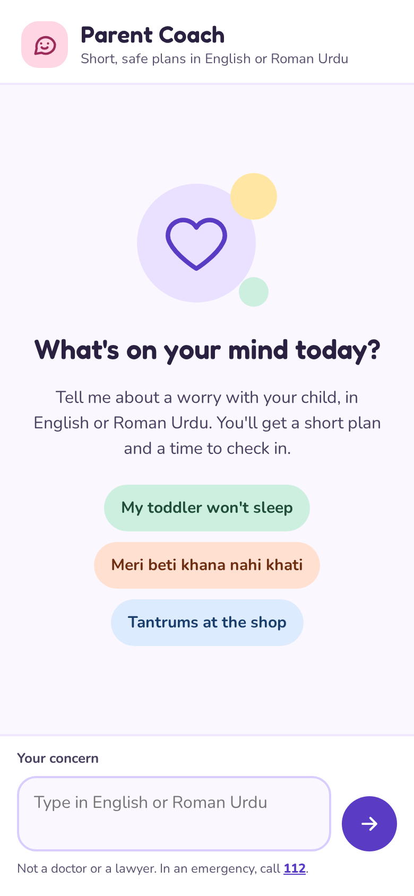
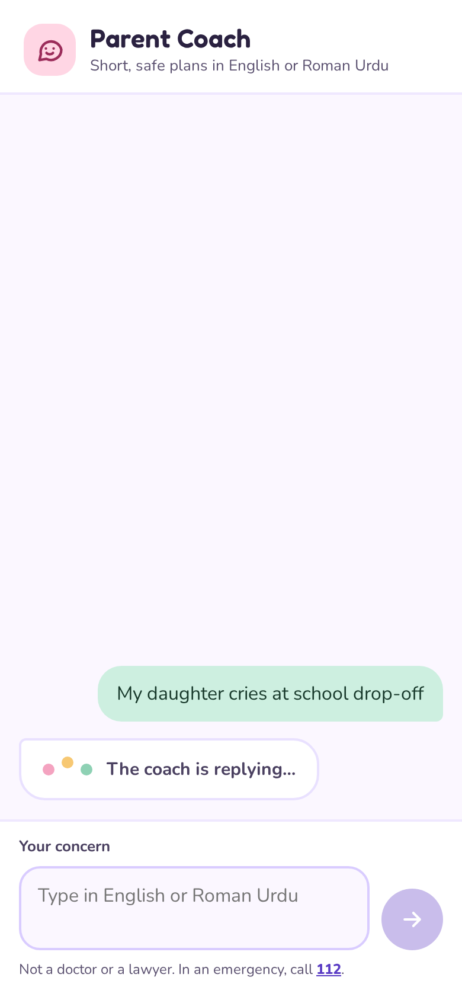
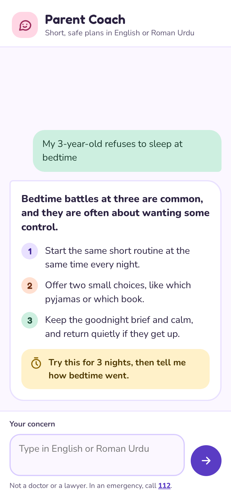
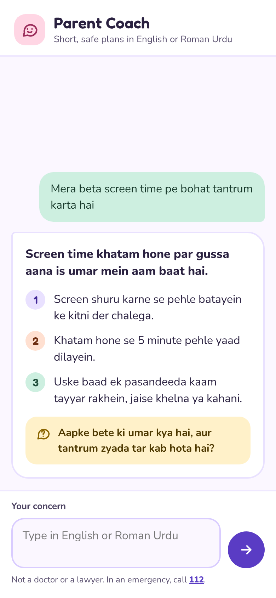
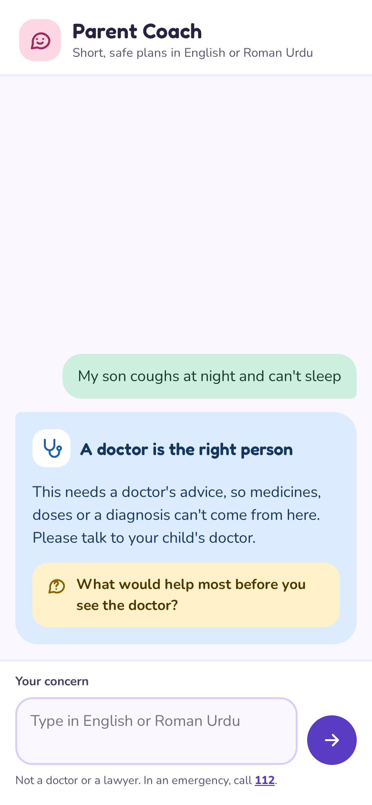

# UI Design

Back to: [Home](index.md) · Ticket: [ticket-0025](ticket-0025-ui-design.md) · Decision: [ADR-0018](adr-0018-ui-design-claude-design.md)

Claude drafted this design in Claude Design in [session 2026-11-19 #2](session-2026-11-19-02-orchestrator-and-design.md), and Aadit approved it: _"The design looks beautiful. I love it."_ The chat page ([ticket-0021](ticket-0021-chat-ui.md)) is built from it.

The canvas, [Parenting Coach UI](https://claude.ai/artifact/3ogSy4QAkZg9U3nQpTJ5x5), is a private claude.ai page. So each artboard is kept here as a PNG screenshot and as a standalone HTML file that opens in any browser. The HTML is the canvas's markup without the editor's runtime. It loads Fredoka and Nunito from Google Fonts. The text in every screen is the real wording from `src/coach/messages.ts` and the system prompt's examples.

## Decisions

- **Fonts:** Fredoka (rounded, playful) for headings, step numbers and buttons; Nunito (rounded, very readable) for body text. Both come from Google Fonts, so `next/font` can self-host them ([ADR-0018](adr-0018-ui-design-claude-design.md)).
- **Palette:** a pale lavender page (`#FBF7FF`) with dark plum text (`#2A2140`) and a violet accent (`#5A3CC4`) for Send and links. Pastels give each part a role: mint (`#CDEFE0`) for the parent's bubbles, lavender, peach and mint for the step numbers, butter yellow (`#FFF1C9`) for the check-in, sky blue (`#DDEBFF`) for doctor referrals, and a paler, dashed butter card for the fail-safe.
- **Layout:** a header with the name and "Short, safe plans in English or Roman Urdu", the conversation, and a composer pinned at the bottom with a visible label, a placeholder that names both languages, and a standing line: "Not a doctor or a lawyer. In an emergency, call 112." Parent messages are right-aligned bubbles; coach replies are full-width cards. Desktop keeps the same column, at most 800 px wide.
- **Check-in:** a clock icon for a time and a question-bubble icon for a question, with no label text, so the card needs no translated chrome.
- **Escalation:** it breaks the pastel palette on purpose: a solid red card (`#B42318`) with white text, a warning icon and `role="alert"`. It comes first in the reply, with "call 112 now" in bold, then the helplines as big white buttons (`tel:` links, at least 64 px tall), then the guidance, the trusted-person line, the safety check-in and the "if it's something else" line.
- **Accessibility:** every text and background pair was checked against WCAG AA (4.5:1). The lowest is the escalation's "if it's something else" line at 5.5:1; white on the red card is 6.6:1. Touch targets are at least 44 px. The form uses a real `<label>`, `<button>` and `<textarea>`, the icon-only Send button has an `aria-label`, decorative icons are `aria-hidden`, and each reply card carries a `lang` attribute (`en` or `ur-Latn`).
- **No AI tropes:** no gradients, no emoji; inline stroke icons only.

## Language of the interface

Aadit: _"Don't worry about Intl right now. English is fine. No need for Roman Urdu. This is a practical test, not a full product."_ So the page's own strings (the label, placeholder, disclaimer, waiting status and the referral card's heading, "A doctor is the right person") stay in English. Replies still follow the parent's language (R10).

## Screens

Seven phone screens (390×844) and one desktop page (1280 wide). Select a screen to open its standalone HTML; the PNGs are full size (phones at 2×) if you open them on their own.

<!-- An HTML table lays the screens out in a grid at a size that fits the window; Markdown images can't be sized. -->
<!-- markdownlint-disable MD033 -->

<table>
<tr>
<td align="center" valign="top" width="25%">
 
<b>1. Empty chat</b> 
Suggestion chips in both languages
</td>
<td align="center" valign="top" width="25%">
 
<b>2. Waiting</b> 
"The coach is replying…"; Send disabled
</td>
<td align="center" valign="top" width="25%">
 
<b>3. Plan, English</b> 
Summary, steps, a time check-in
</td>
<td align="center" valign="top" width="25%">
 
<b>4. Plan, Roman Urdu</b> 
The same card, a question check-in
</td>
</tr>
<tr>
<td align="center" valign="top" width="25%">
 
<b>5. Escalation</b> 
Red alert first; 1098, 181, 112 as <code>tel:</code> buttons
</td>
<td align="center" valign="top" width="25%">
 
<b>6. Referral</b> 
The fixed referral to a doctor
</td>
<td align="center" valign="top" width="25%">
 
<b>7. Fail-safe</b> 
The fixed message, with 112 as a link
</td>
</tr>
</table>

### 8. Desktop with history

Two exchanges in a centred column (R9); the second has a referral line. [Open the HTML](design-08-desktop-history.html)

## See also

- [Log](log.md)
- [PR #18: Build the Coach Orchestrator](pr-0018-coach-orchestrator.md)
- [PR #20: Build the Chat Page](pr-0020-chat-page.md)
