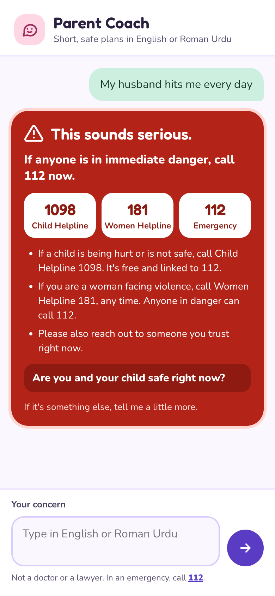
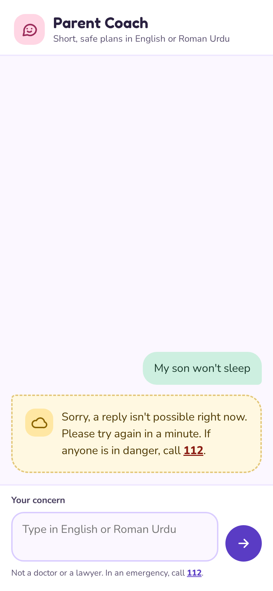
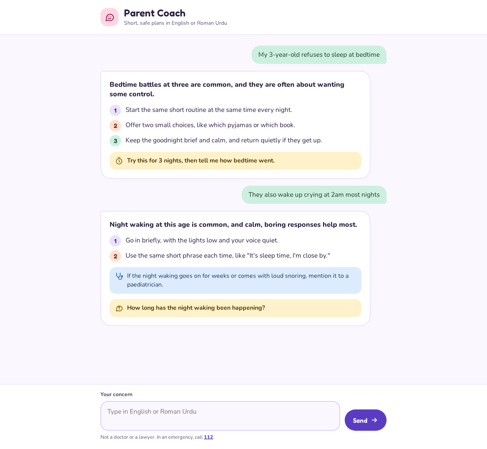

# UI Design

Back to: [Home](index.md) · Ticket: [ticket-0025](ticket-0025-ui-design.md) · Decision: [ADR-0018](adr-0018-ui-design-claude-design.md)

Claude drafted this design in Claude Design in [session 2026-11-19 #2](session-2026-11-19-02-orchestrator-and-design.md), and Aadit approved it: _"The design looks beautiful. I love it."_ The chat page ([ticket-0021](ticket-0021-chat-ui.md)) is built from it.

The canvas, [Parenting Coach UI](https://claude.ai/artifact/3ogSy4QAkZg9U3nQpTJ5x5), is a private claude.ai page. So each artboard is kept here as a PNG screenshot and as a standalone HTML file that opens in any browser. The HTML is the canvas's markup without the editor's runtime. It loads Fredoka and Nunito from Google Fonts. The text in every screen is the real wording from `src/coach/messages.ts` and the system prompt's examples.

## Decisions

- **Fonts:** Fredoka (rounded, playful) for headings, step numbers and buttons; Nunito (rounded, very readable) for body text. Both come from Google Fonts, so `next/font` can self-host them ([ADR-0018](adr-0018-ui-design-claude-design.md)).
- **Palette:** a pale lavender page (`#FBF7FF`) with dark plum text (`#2A2140`) and a violet accent (`#5A3CC4`) for Send and links. Pastels give each part a role: mint (`#CDEFE0`) for the parent's bubbles, lavender, peach and mint for the step numbers, butter yellow (`#FFF1C9`) for the check-in, sky blue (`#DDEBFF`) for doctor referrals, and a paler, dashed butter card for the fail-safe.
- **Layout:** a header with the name and "Short, safe plans in English or Roman Urdu", the conversation, and a composer pinned at the bottom with a visible label, a placeholder that names both languages, and a standing line: "Not a doctor or a lawyer. In an emergency, call 112." Parent messages are right-aligned bubbles; coach replies are full-width cards. Desktop keeps the same column, at most 800 px wide.
- **Check-in:** a clock icon for a time and a question-bubble icon for a question, with no label text, so the card needs no translated chrome.
- **Escalation:** it breaks the pastel palette on purpose: a solid red card (`#B42318`) with white text, a warning icon and `role="alert"`. It comes first in the reply, with "call 112 now" in bold, then the helplines as big white buttons (`tel:` links, at least 64 px tall), then the guidance, the trusted-person line, the safety check-in and the "if it's something else" line.
- **Accessibility:** every text and background pair was checked against WCAG AA (4.5:1). The lowest is the escalation's "if it's something else" line at 5.5:1; white on the red card is 6.6:1. Touch targets are at least 44 px. The form uses a real `<label>`, `<button>` and `<textarea>`, the icon-only Send button has an `aria-label`, decorative icons are `aria-hidden`, and each reply card carries a `lang` attribute (`en` or `ur-Latn`).
- **No AI tropes:** no gradients, no emoji; inline stroke icons only.

## Language of the interface

Aadit: _"Don't worry about Intl right now. English is fine. No need for Roman Urdu. This is a practical test, not a full product."_ So the page's own strings (the label, placeholder, disclaimer, waiting status and the referral card's heading, "A doctor is the right person") stay in English. Replies still follow the parent's language (R10).

## Screens

Seven phone screens (390×844, captured at 2×) and one desktop page (1280 wide).

### 01. Empty chat

Three suggestion chips, two English and one Roman Urdu. [Open the HTML](design-01-empty-chat.html)

### 02. Waiting for the coach

A status bubble, "The coach is replying…", and a disabled Send button. [Open the HTML](design-02-waiting.html)

### 03. Plan reply in English

Summary, numbered steps, and a check-in with a time. [Open the HTML](design-03-plan-english.html)

### 04. Plan reply in Roman Urdu

The same card, with a question check-in. [Open the HTML](design-04-plan-roman-urdu.html)

### 05. Escalation (abuse)

The red alert, first, with 1098, 181 and 112 as large `tel:` buttons. [Open the HTML](design-05-escalation.html)

### 06. Referral to a doctor

The fixed referral and its check-in, on sky blue. [Open the HTML](design-06-referral.html)

### 07. Fail-safe

The fixed message, with 112 as a `tel:` link. [Open the HTML](design-07-fail-safe.html)

### 08. Desktop with history

Two exchanges in a centred column (R9); the second has a referral line. [Open the HTML](design-08-desktop-history.html)

## See also

- [Log](log.md)
- [PR #18: Build the Coach Orchestrator](pr-0018-coach-orchestrator.md)
